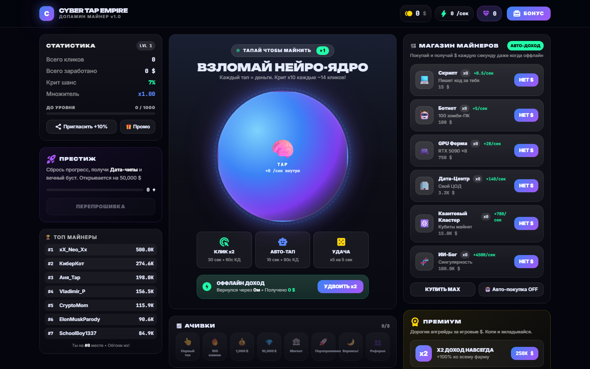

# CYBER TAP EMPIRE — кликер-майнер

> Idle clicker game for the browser and Telegram Mini Apps. Vite + vanilla JS, offline income, prestige, achievements.

**▶ Демо: https://quorvox.github.io/cyber-tap-empire/**



Тапаешь по нейро-ядру, покупаешь майнеры, копишь оффлайн-доход и делаешь престиж ради вечного буста. Работает в браузере, на телефоне и внутри Telegram как Mini App.

## Механики

- **6 майнеров** с растущей ценой (×1.15 за каждый), доход в секунду
- **Крит-клики** x10, бусты: клик x2, авто-тап, удача x5 (с кулдаунами)
- **Оффлайн-доход** до 24 часов, удвоить можно 1 раз за заход
- **Престиж**: сброс прогресса за дата-чипы, они дают вечный множитель
- **Премиум за игровую валюту**: X2 навсегда, мега-буст, скины ядра
- Ачивки, ежедневный бонус со стриком, промокоды, рефералка, лидерборд
- Сохранение в `localStorage` каждые 2 секунды

## Стек

Vite, Tailwind (CDN), ванильный JS без фреймворков, Telegram WebApp SDK.

## Запуск

```bash
npm install
npm run dev      # http://localhost:5173
npm run build    # dist/ — можно сразу на GitHub Pages / Netlify
```

Чтобы открыть как Mini App: залить `dist/` на HTTPS-хостинг и указать ссылку в @BotFather → Bot Settings → Menu Button.

---
Сделано [Quorvox_team](https://github.com/Quorvox)
